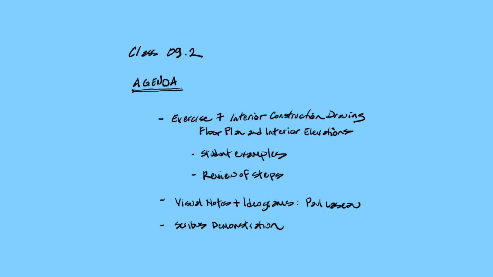
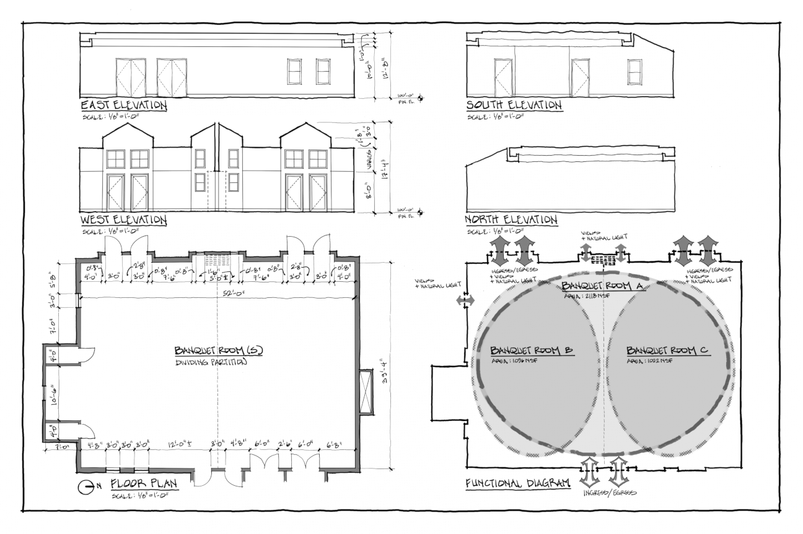
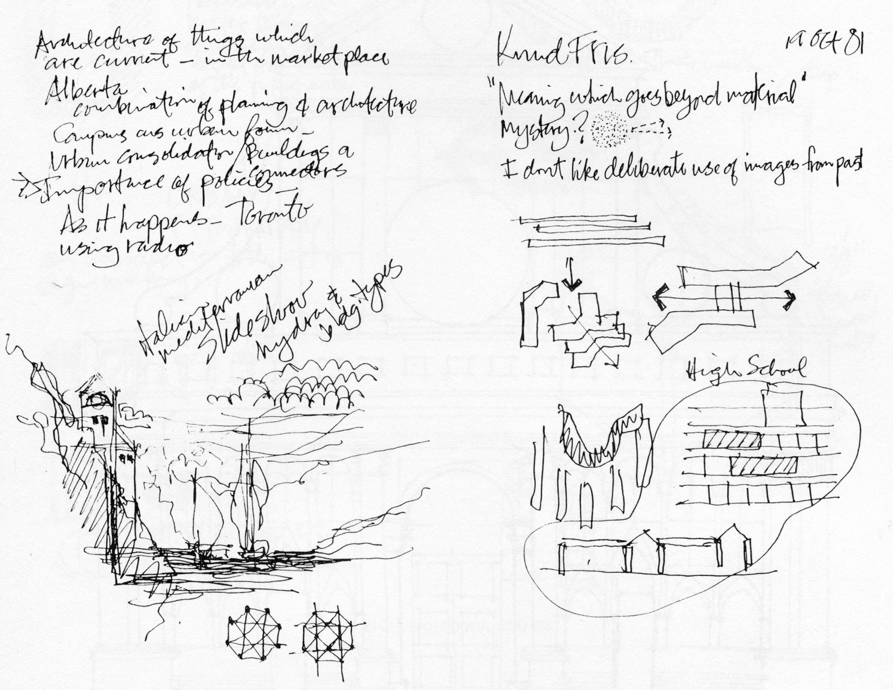
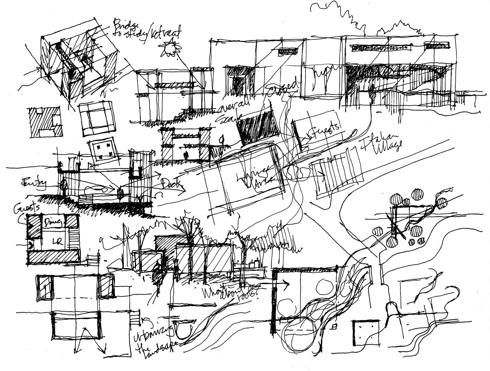
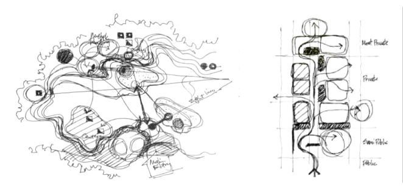

[Frequently Asked Questions: FAQ](FAQ.html)

<iframe height="420" width="640" allowfullscreen frameborder=0 src="https://echo360.org/media/389e4548-4077-45b4-8756-d15fe0acfc23/public?autoplay=false&automute=false"></iframe>

[Exercise 7 Examples](images/ex7_examples.zip)
