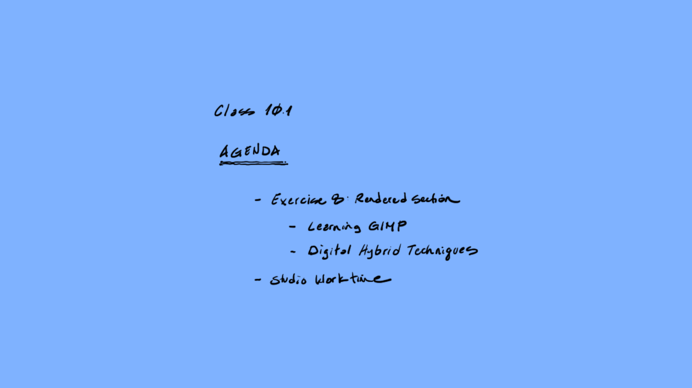
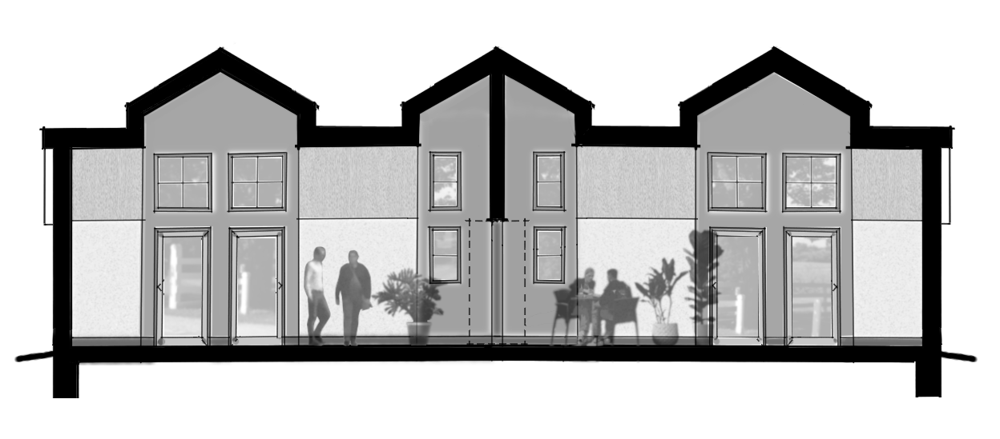

[Frequently Asked Questions: FAQ](FAQ.html)

<iframe height="420" width="640" allowfullscreen frameborder=0 src="https://echo360.org/media/96a78692-5b0e-4669-b66a-52570da85be2/public?autoplay=false&automute=false"></iframe>

[Exercise 8 Examples](images/ex8_examples.zip)
