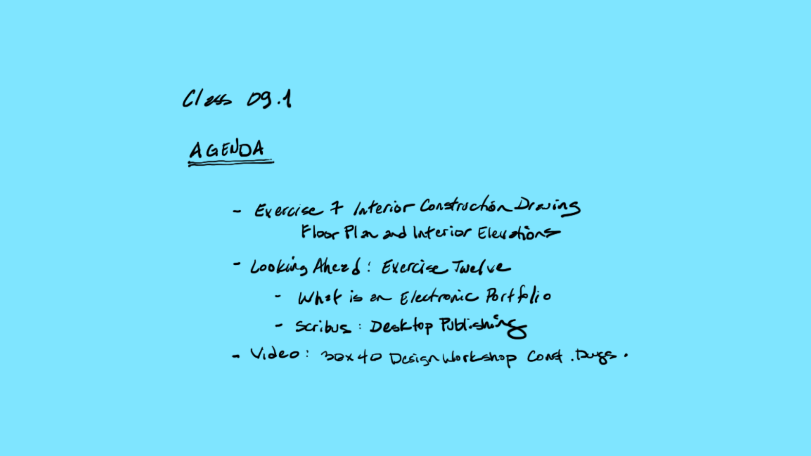

[Frequently Asked Questions: FAQ](FAQ.html)

<iframe height="420" width="640" allowfullscreen frameborder=0 src="https://echo360.org/media/ff3bf364-25d9-4eb7-a9e0-a58678c3df2f/public?autoplay=false&automute=false"></iframe>
