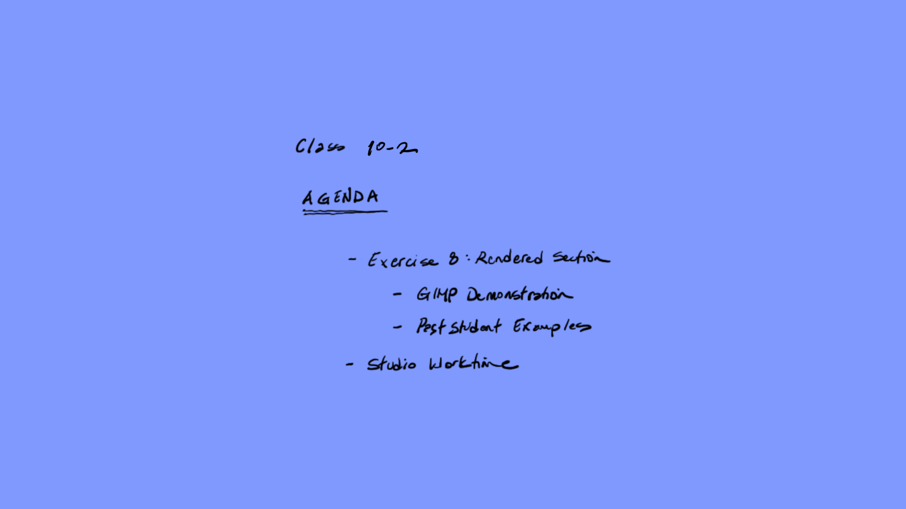

[Frequently Asked Questions: FAQ](FAQ.html)

<iframe height="420" width="640" allowfullscreen frameborder=0 src="https://echo360.org/public/media/5b9e9bb5-696d-4156-a0ae-a96920a9d082?autoplay=false&automute=false"></iframe>

<iframe height="420" width="640" allowfullscreen frameborder=0 src="https://echo360.org/public/media/bb32669a-0a8f-46c7-9fda-cff63f7aaa6f?autoplay=false&automute=false"></iframe>

[Exercise 8 Examples](images/ex8_examples.zip)
